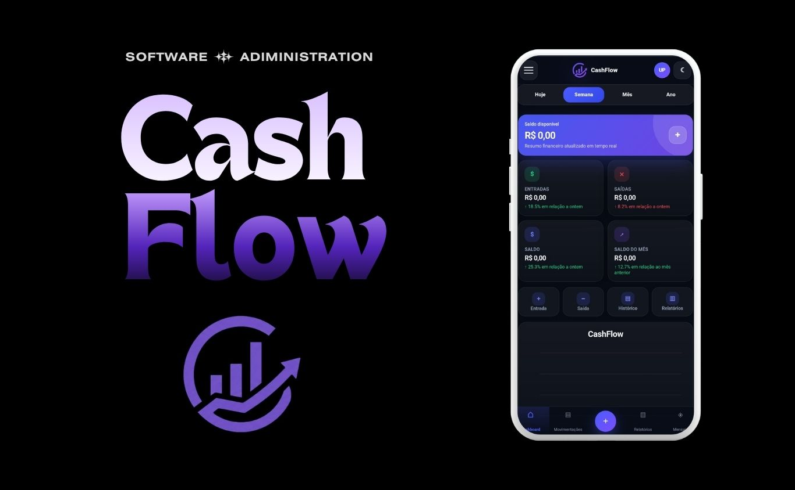
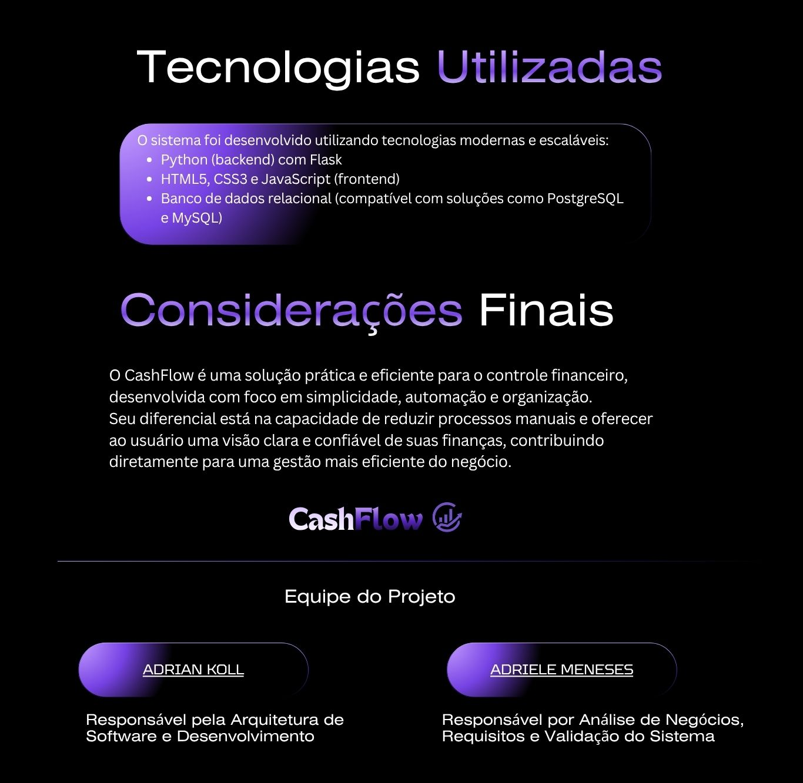

# 💸 CashFlow

<p align="center">
  
</p>

<p align="center">
  <strong>Mobile Financial Management System</strong>
</p>

<p align="center">
  A modern mobile-first financial management web application developed with Flask.
</p>

---

<p align="center">
  
  
  
  
</p>

---

# 📱 About the Project

CashFlow is a mobile-first financial management web application developed to simplify financial organization for entrepreneurs, small businesses and personal finance management.

The project combines:

- Financial automation
- Modern UI/UX
- Responsive mobile interface
- Business-oriented planning
- Modular Flask architecture
- User-friendly experience

The application was designed primarily for smartphones while maintaining desktop compatibility.

---

# 🚀 Main Features

## 💰 Financial Management

- Income registration
- Expense registration
- Real-time balance updates
- Financial history management
- Daily, weekly, monthly and yearly filters
- Financial reports

---

## 🔄 Monthly Expense Automation

One of the main differentials of CashFlow is its recurring expense automation system.

The system allows users to:

- Register reusable products
- Configure recurring expenses
- Automatically calculate expense totals
- Generate monthly recurring records
- Maintain financial consistency

This significantly reduces manual work and improves financial organization efficiency.

---

## 📲 Mobile-First Experience

CashFlow was designed with focus on mobile usability.

### The interface includes:

- Responsive design
- Fast navigation
- Clean UI structure
- Smartphone optimization
- Dark mode support
- User-friendly financial management

---

# 🖼️ Presentation & Documentation

This repository includes a dedicated documentation structure containing visual presentation materials, business-oriented assets and project showcase images.

---

# 📂 Documentation Structure

```bash
/docs
│
└── presentation/
    ├── capa.jpg
    ├── visão geral e objetivo.jpg
    ├── como funciona o sistema.jpg
    └── diferenciais.jpg
```

---

# 📸 Project Presentation

## 🚀 Product Showcase

<p align="center">
  
</p>

---

## 🧠 Overview & Objectives

<p align="center">
  
</p>

---

## ⚙️ Features & System Flow

<p align="center">
  
</p>

---

## 💎 Business Differentials

<p align="center">
  
</p>

---

# 🧩 Technologies Used

## Backend

- Python
- Flask
- SQLAlchemy
- SQLite
- PostgreSQL Compatible

---

## Frontend

- HTML5
- CSS3
- JavaScript

---

## Architecture

- Modular Flask Architecture
- Responsive Design
- Component-Based UI
- Mobile-First Structure

---

# 🤝 Collaborative Development

This project was developed collaboratively between software engineering and business analysis areas.

---

## 👨‍💻 Adrian Koll

Responsible for:

- Software Architecture
- Backend Development
- Frontend Development
- Database Structuring
- System Engineering
- Mobile Web Interface Development

---

## 👩‍💼 Adrielle Meneses

Responsible for:

- Business Analysis
- Requirements Gathering
- Product Validation
- Strategic Planning
- User Flow Structuring
- Presentation Slides & Documentation

---

This collaboration allowed the project to combine technical implementation with strategic business vision and usability planning.

---

# 📦 Project Structure

```bash
CashFlow/
│
├── app/
├── static/
├── templates/
│
├── docs/
│   └── presentation/
│       ├── capa.jpg
│       ├── visão geral e objetivo.jpg
│       ├── como funciona o sistema.jpg
│       └── diferenciais.jpg
│
├── requirements.txt
├── run.py
└── README.md
```

---

# ⚡ How to Run the Project

## 1️⃣ Clone the Repository

```bash
git clone https://github.com/YOUR_USERNAME/CashFlow.git
```

---

## 2️⃣ Access the Project Folder

```bash
cd CashFlow
```

---

## 3️⃣ Create a Virtual Environment

### Windows

```bash
python -m venv venv
```

---

## 4️⃣ Activate the Virtual Environment

### Windows

```bash
venv\Scripts\activate
```

---

## 5️⃣ Install Dependencies

```bash
pip install -r requirements.txt
```

---

## 6️⃣ Run the Application

```bash
python run.py
```

---

## 7️⃣ Access the System

Open your browser:

```txt
http://127.0.0.1:5000
```

---

# 🎯 Project Goals

CashFlow was created to demonstrate:

- Real-world financial management solutions
- Flask backend architecture
- Mobile-first web development
- Business-oriented software planning
- UI/UX focused applications
- Strategic product development

---

# 🔮 Future Improvements

- User authentication
- Cloud synchronization
- Financial dashboards
- Push notifications
- Advanced reports
- PWA enhancements
- API integrations
- Data analytics

---

# 📌 Final Considerations

CashFlow is more than a financial control application.

The project was structured as a business-oriented software solution focused on usability, automation, organization and strategic product planning.

The repository also includes visual presentation materials and documentation assets used during the planning and validation phases of the system.

---

# ⭐ Support the Project

If you liked the project, consider giving the repository a star on GitHub.
